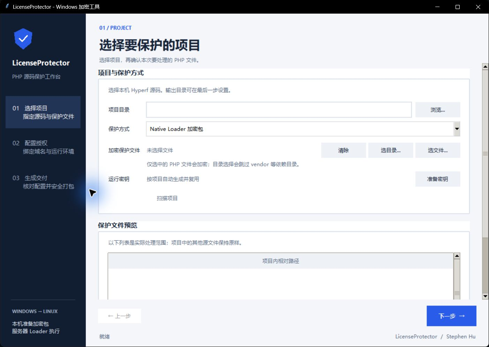
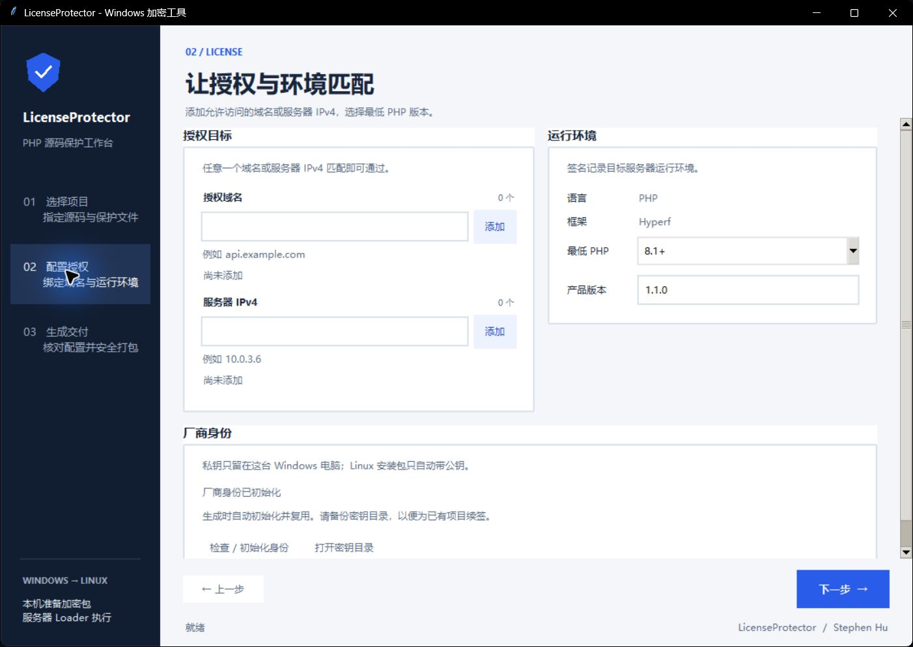
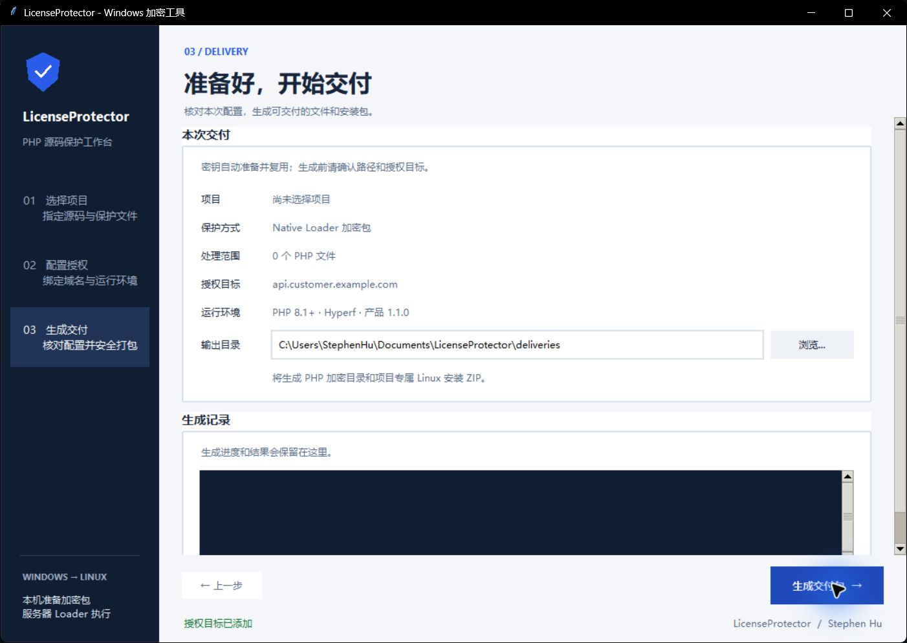
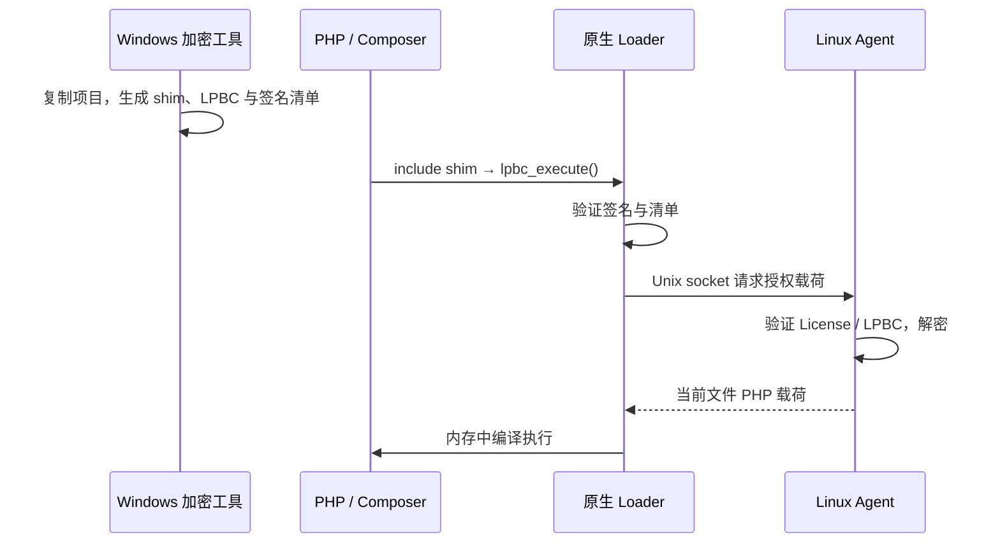

# LicenseProtector · PHP 源码授权保护工具

Windows 端选择 PHP 文件、配置授权并生成交付包；Linux 端安装自研 Agent 和 PHP Loader，在运行时解密执行。项目不接入 ionCube，也不需要向厂商服务器在线验证授权。

版本：**1.1.0** · Windows GUI：**Python / Tkinter** · 授权签名：**Ed25519** · 加密容器：**AES-256-GCM / LPBC**

> **使用前必读：当前 Hyperf 集成有兼容边界。不要加密含 `#[Inject]`、`@Inject`、路由、AOP 或其他框架扫描元数据的类；Controller、基础控制器、框架入口和配置先保留明文。优先保护独立算法、业务规则和不依赖这些机制的类。Service 也需要逐个检查，不能整目录盲选。**

## 目录

- [功能与两种交付模式](#功能与两种交付模式)
- [界面与 Windows 使用步骤](#界面与-windows-使用步骤)
- [哪些 PHP 文件可以加密](#哪些-php-文件可以加密)
- [加密与解密路径](#加密与解密路径)
- [项目结构与安装包区别](#项目结构与安装包区别)
- [环境要求](#环境要求)
- [Linux 安装与验收](#linux-安装与验收)
- [密钥管理与安全边界](#密钥管理与安全边界)
- [开发、测试与构建](#开发测试与构建)
- [常见故障](#常见故障)
- [相关文档与许可证](#相关文档与许可证)

## 功能与两种交付模式

- 在临时交付副本中处理项目，原始项目保持不变。
- Native 模式只加密选择的 PHP 文件；原路径生成调用 Loader 的 PHP 引导文件（shim）。目录选择会跳过 `vendor` 等依赖目录，但**不会替你确认 Hyperf 注入兼容性**。
- 支持多个授权域名、多个 IPv4：任一配置目标匹配即可通过（Domain OR IPv4）。
- 对 License、LPBC 及完整性清单签名，校验失败时拒绝加载。
- GUI 自动初始化并复用厂商身份，按项目准备运行密钥。
- Native 模式生成 PHP 交付目录及配套的项目专属 Linux 安装 ZIP。
- Linux 安装器使用目标 PHP 的开发工具编译扩展，配置 systemd Agent 服务并启动。
- Hyperf 请求通过授权中间件检查 Host，常驻应用更新 Loader 后需要重启。

| 模式 | 保护方式 | Linux 运行要求 | 适用情况 |
| --- | --- | --- | --- |
| Native Loader 加密包（默认） | 选中文件放入 LPBC 加密容器，由原生扩展加载 | Agent、匹配 PHP ABI 的 Loader、配套密钥 | 需要隐藏选中业务代码 |
| 标准授权包 | 授权检查、签名完整性校验；选中文件可移除普通注释和冗余空白 | PHP 及授权校验所需扩展 | 保留可读代码，主要限制交付授权 |

标准模式的文本加固**不是源码加密**。Native 当前普通交付的载荷是 `php-source-v1`，在内存里交给 Zend 编译器执行；不是 ionCube 格式，也不是预编译 Zend opcode 产品。实验性 `ir-v1` 不作为普通项目交付方式。

## 界面与 Windows 使用步骤

以下截图采集自当前源码的真实界面，展示操作位置；空白配置不代表完成了加密或部署。

### 1. 安装与启动

正常使用运行 `LicenseProtector-Windows加密工具-Setup.exe`。安装向导允许指定安装目录，并记住上次目录；启动窗口默认居中。便携使用运行 `LicenseProtector-Windows-Encryptor.exe`，不需要安装。

这两个程序是**Windows 厂商加密工具**，不要上传 Linux。仓库只跟踪源码、脚本和文档，EXE / ZIP 安装包不随 `git clone` 下载；已有安装包在本地对应的 `安装包/` 目录，也可以按[构建步骤](#开发测试与构建)生成。

### 2. 选择项目与文件



1. 浏览到原 PHP 后端根目录，如 `D:\Projects\BackEnd`，目录中应包含项目入口及 Composer 配置。
2. 选择 `Native Loader 加密包`。
3. 使用“选文件”或“选目录”添加范围，再检查右侧文件列表；移除 Controller、注入类、配置及其他不适合加密的文件。
4. 可以点击“扫描项目”检查入口。运行密钥按项目自动准备并复用，通常无需手工选择。

### 3. 配置授权与 PHP 环境



1. 添加客户实际访问的域名，例如 `api.customer.example.com`，多个目标可以逐个添加。
2. 需要 IPv4 授权时添加服务器地址；不要填写访问者的 IP。
3. 根据后端实际依赖选择最低 PHP 版本。**界面的最低版本不会升级服务器 PHP，也不能让要求 PHP 8.2 的 Composer 依赖在 PHP 8.1 上运行。**
4. 设置产品版本。厂商身份会在生成时自动初始化，也可点击“检查 / 初始化身份”。

域名不应写成包含业务路径的 URL；授权检查采用标准化后的目标匹配，不使用字符串包含关系。反向代理和 NAT 环境需要核对应用接收到的 Host 与服务器地址。

### 4. 生成交付



1. 核对项目、文件数量、授权目标和 PHP 环境。
2. 设置独立输出目录，例如 `D:\Deliveries\CustomerA\BackEnd`，不要覆盖原始项目。
3. 点击“生成交付包”，查看生成记录；完成后打开交付目录。
4. Native 模式会生成 PHP 交付目录，并在输出目录旁生成项目专属 Linux 安装 ZIP。二者必须配套使用。

将 PHP 交付内容放到服务器**原后端对应位置**，保留应用原有部署路径；Linux ZIP 解压到网站目录之外。更新交付时不要手工拼接不同批次的 `license.dat`、manifest、shim 和 `.lpbc`。

## 哪些 PHP 文件可以加密

**不是所有接口都永远不能加密，而是当前工具尚未完整兼容 Hyperf 的源码扫描、DI 和 AOP 流程。** PHP 能反射到 `Inject` 属性，不等于 Hyperf 能在引导文件替代源文件后生成正确的依赖注入代理。

| 文件或机制 | 当前建议 | 原因 |
| --- | --- | --- |
| `#[Inject]` / `@Inject` 属性注入、注解扫描 | 暂不加密 | 属性注入可能未执行，导致 typed property 未初始化 |
| Controller、AbstractController、路由注解/属性 | 暂保留明文 | 依赖路由注册、继承属性注入及框架扫描 |
| AOP、切面、代理生成相关类 | 暂不加密 | 框架可能需要读取和改写原始源码 |
| 带上述元数据的 Service、Listener、Process | 暂不加密 | 类名和目录不能证明其不依赖框架机制 |
| 入口、启动文件、容器/路由/中间件配置 | 保留明文 | 框架初始化与保护加载链需要可用 |
| `vendor/` 与第三方依赖 | 不作为加密目标 | 保留 Composer 与框架正常工作所需内容 |
| 独立计算、定价规则、编码转换、纯函数 | 优先选择，小范围验证 | 不依赖框架扫描，适合抽出核心算法 |
| 仅使用 PHP 原生构造器传参的独立类 | 可尝试并验证 | 必须确认没有隐藏的扫描、代理或反射文件读取依赖 |

推荐把业务核心从控制器中提取：Controller 保留路由、请求读取和 Inject；将值传给独立业务类，独立类返回结果。需要访问框架服务时由明文层传入必要参数，避免在加密类内部依赖属性注入。

```php
// 可优先选择的小范围加密对象：不依赖 Hyperf 注解、属性注入或 AOP。
namespace App\Domain;

final class PriceRule
{
    public function calculate(int $unitPrice, int $quantity): int
    {
        return $unitPrice * $quantity;
    }
}
```

相反，包含 `#[Inject] protected RequestInterface $request;` 或 `/** @Inject */` 的类应先排除。**即使 AbstractController 未加密，加密 AuthController 等子类仍可能破坏代理/注入链。** 排除基类一个文件不能保证整个接口正常。

验证顺序：先用明文版本确认后端正常 → 只选择一个独立业务文件 → 安装配套 Loader/Agent → 重启后端 → 测试实际调用该文件的接口及后台任务 → 再扩大范围。当前选择界面没有完整的元数据兼容性分析器，判断与接口回归测试由使用者执行。

## 加密与解密路径

以 `app/Domain/PriceRule.php` 为例，以下路径相对于现有 PHP 项目根目录。

| 阶段 | 文件/位置 | 动作 |
| --- | --- | --- |
| Windows 原始项目 | `app/Domain/PriceRule.php` | 保留原始源码，复制到交付工作区 |
| Windows 生成 | `protected/lpbc/app/Domain/PriceRule.lpbc` | 将选中文件加密、签名，生成 LPBC |
| PHP 交付目录 | `app/Domain/PriceRule.php` | 变为调用 `lpbc_execute()` 的 PHP shim |
| PHP 交付目录 | `license.dat`、`protected/lpbc/manifest.json`、`manifest.sig` | 保存签名授权和文件完整性信息 |
| Linux Loader | PHP 进程中的 `license_loader.so` | 校验签名/清单，通过本机 socket 请求 Agent |
| Linux Agent | `/run/license-protector/agent.sock` | 根据配置验证授权和 LPBC，使用运行密钥解密 |
| PHP 执行 | PHP 进程内存 | Loader 接收当前载荷，调用 Zend 编译器执行；不将解密源码写回磁盘 |



Agent 是本机授权与解密服务，**不是大模型 Agent**，不需要 API Key 或模型配置。授权运行不回连厂商服务器；首次安装 Python 依赖可能需要联网，也可以由管理员提前准备依赖。

## 项目结构与安装包区别

```text
WatchDog/
├── README.md
├── docs/screenshots/                   # README 的实际界面截图
├── Windows加密工具/
│   ├── Windows端安装与首次使用.md
│   ├── 安装包/                          # 本地构建输出，不纳入 Git
│   │   ├── LicenseProtector-Windows加密工具-Setup.exe
│   │   └── LicenseProtector-Windows-Encryptor.exe
│   └── 源码/LicenseProtector-Windows-Source/
│       ├── app/                         # GUI、CLI、扫描、签名与交付构建
│       ├── deploy/                      # 交付 ZIP 所需安装脚本
│       ├── native/                      # 交付 ZIP 所需 Loader 源码
│       ├── installer/                   # EXE、Setup、Linux ZIP 构建
│       └── tests/
└── Linux授权服务端/
    ├── 安装命令-填写PHP版本.md
    ├── 清理命令.md
    ├── 安装包/                          # 通用源码 ZIP，不纳入 Git
    └── 源码/LicenseProtector-Linux-Agent/
        ├── app/                         # Agent 与授权校验
        ├── deploy/                      # systemd 与安装脚本
        └── native/                      # PHP 扩展源码与自检
```

| 文件 | 给谁使用 | 是否包含项目密钥 |
| --- | --- | --- |
| Windows Setup / 便携 EXE | 厂商 Windows 电脑 | 不是客户专属密钥交付包；运行后在本机管理密钥 |
| 通用 Linux 源码部署 ZIP | 开发者/管理员维护 | 不包含项目运行密钥，不能独立完成客户部署 |
| GUI 生成的项目专属 Linux 安装 ZIP | 对应项目的 Linux 管理员 | 包含运行密钥和厂商公钥；不含厂商私钥 |
| PHP 加密交付目录 | 客户原 PHP 后端目录 | 包含 LPBC、签名清单、License；主运行密钥放在 Agent 配置目录 |

Windows 源码中的 Agent/Loader 副本供打包器收集交付文件。修改这些共享文件时需要同步 Linux 源码副本，避免安装包带入旧版本。

## 环境要求

| 环境 | 要求 |
| --- | --- |
| Windows 日常使用 | 已构建的 GUI EXE；无需另装 Python |
| Windows 源码开发 | Python 3.11+、Tkinter、`cryptography`；测试使用 `pytest` |
| Windows 构建 | PyInstaller；生成 Setup 还需 Inno Setup 6 |
| Linux 服务 | systemd、Python 3.11+ / venv、`cryptography`、可用的 PHP 运行用户/组 |
| Loader 构建 | C 编译器、make、autoconf / PHP 构建工具、pkg-config、OpenSSL、libsodium 开发文件 |
| PHP | 与应用依赖一致的版本；配套 `phpize`、`php-config`、开发头文件；框架本身所需扩展 |

界面提供 PHP 8.0–8.4 的最低版本选项，**不表示所有操作系统、PHP 构建和框架组合都已测试通过**。PHP 主/次版本、模块 API、线程安全模式和架构必须与 Loader 兼容；8.1 的 `.so` 不能直接用于 8.2。标准授权路径需要 PHP sodium；Hyperf 的 Swoole/其他依赖仍按项目要求准备。

## Linux 安装与验收

### 安装前准备

1. 确认后端实际用哪个 PHP 二进制，检查 Composer 要求；不要只看宝塔网站选中的 FPM 版本。Hyperf 使用自己的 CLI 常驻进程。
2. 把 PHP 交付内容部署到原后端路径。
3. 将对应项目的 Linux 安装 ZIP 解压到 `/root/LicenseProtector-Linux-Installer`（或你自己的安装暂存目录）。已经解压后不再需要 ZIP 参与安装。
4. 确认其中包含 `install.sh`、`runtime.key`、`vendor_public.pem`、`native/`、`app/` 和 `deploy/`。
5. 准备匹配 PHP 的开发工具及系统依赖。

完整的带预检查命令见 [安装命令：填写 PHP 版本](Linux授权服务端/安装命令-填写PHP版本.md)。下面是宝塔环境的安装调用示例，**修改顶部变量后整段复制**；不会移动你的 PHP 项目目录。

```bash
(
set -Eeuo pipefail
trap 'echo "安装失败：行号=$LINENO；请检查上方错误。" >&2' ERR

# 按实际环境填写；82 和 8.2 均可。不要填写补丁号。
PHP_VERSION='8.2'
PHP_BASE_DIR='/www/server/php'
INSTALLER_DIR='/root/LicenseProtector-Linux-Installer'
PROJECT_ROOT='/www/wwwroot/customer.example.com/BackEnd'
PHP_USER='www'
PHP_GROUP='www'

PHP_BIN_DIR="$PHP_BASE_DIR/${PHP_VERSION//./}/bin"
cd "$INSTALLER_DIR"
PHPIZE="$PHP_BIN_DIR/phpize" \
PHP_CONFIG="$PHP_BIN_DIR/php-config" \
PATH="$PHP_BIN_DIR:$PATH" \
bash ./install.sh \
  --project-root "$PROJECT_ROOT" \
  --php "$PHP_BIN_DIR/php" \
  --php-user "$PHP_USER" \
  --php-group "$PHP_GROUP"

systemctl is-active --quiet license-agent
test -S /run/license-protector/agent.sock
"$PHP_BIN_DIR/php" "$INSTALLER_DIR/native/selfcheck.php"
systemctl status license-agent --no-pager -l
)
```

非宝塔环境直接在 `--php`、`PHPIZE`、`PHP_CONFIG` 中填写实际工具路径。NAT/IP 绑定时可使用安装器的 `--server-ipv4` 参数指定服务器地址；以管理员确认的地址为准。

固定安装结果：

| 路径/名称 | 用途 |
| --- | --- |
| `/opt/license-protector-agent` | Agent 源码和独立 Python 环境 |
| `/etc/license-protector/runtime.key` | 项目运行解密密钥 |
| `/etc/license-protector/vendor_public.pem` | 验证签名的厂商公钥 |
| `/etc/license-protector/agent.json` | 当前项目路径、socket 和密钥配置 |
| `/run/license-protector/agent.sock` | PHP → Agent 的本机通信入口 |
| `license-agent.service` | systemd 服务及开机启动 |
| 目标 PHP 的 extension-dir | `license_loader.so`；由目标 PHP 的工具编译 |

当前安装器使用固定的一个服务、一个运行密钥及一个项目配置，**不是多项目管理平台**。不要将第二个独立项目直接覆盖到已有服务；不同密钥/公钥会被拒绝覆盖。

### 安装后验证

1. Agent 是 `active`，socket 存在。
2. 使用后端实际 PHP 测试 `extension_loaded('license_loader')` 与 `function_exists('lpbc_execute')`，都应为 `true`。
3. 在宝塔或你原有守护工具中重启**这个后端对应的常驻任务**，启动 PHP 与安装 PHP 必须相同。FPM reload 不会更新 Hyperf 进程中的扩展。
4. 用真实授权域名调用业务接口，并检查当前时间的日志；CLI 自检成功不等于接口验收成功。
5. 检查拒绝场景：所有域名/IP 都不匹配、签名被改动、LPBC 被改动时应拒绝。测试时使用隔离副本。

## 密钥管理与安全边界

| 密钥 | 谁持有 | 用途 | 可以上传 Linux 吗 |
| --- | --- | --- | --- |
| `vendor_private.pem` | 厂商 Windows 端 | 签发授权、签名保护文件 | **不可以** |
| `vendor_public.pem` | Windows 与 Linux | 验证厂商签名 | 可以，由部署包携带 |
| `runtime.key` | Windows 编码端与 Linux Agent | 加密/解密当前项目载荷 | 仅配套服务部署，限制访问 |

默认厂商身份目录为 `%LOCALAPPDATA%\LicenseProtector\keys`。GUI 自动管理密钥，三种用途在界面中简化，不代表底层可以混用。备份厂商身份及项目运行密钥；随意重新生成会使旧交付无法正常续签或解密。

保护目标是提高直接复制、篡改和分析的成本。拥有服务器 root、调试 PHP/Agent 进程或访问授权 socket 的人员仍可能提取内存中的源码或修改运行环境；因此不能承诺“无法破解”。域名/IP 检查也不能替代服务器可信边界，特别是本机管理员能够修改环境或构造 Host 时。

当前格式不是 ionCube 等商业产品的等价实现。限制 Agent/socket/配置权限、保护厂商私钥、保持加密交付与部署包配套，是现有方案的必要组成部分。

## 开发、测试与构建

在仓库根目录执行以下 PowerShell 命令建立环境，再进入 Windows 源码目录启动。

```powershell
git clone git@github.com:StephenHu03/WatchDog.git
cd WatchDog
py -3 -m venv .venv
$Python = (Resolve-Path '.venv\Scripts\python.exe').Path
$Source = (Resolve-Path 'Windows加密工具\源码\LicenseProtector-Windows-Source').Path
& $Python -m pip install -r "$Source\requirements.txt"
Push-Location $Source
try {
    & $Python -m app.main
} finally {
    Pop-Location
}
```

单元与 GUI 工作流测试：

```powershell
$Python = (Resolve-Path '.venv\Scripts\python.exe').Path
Push-Location 'Windows加密工具\源码\LicenseProtector-Windows-Source'
try {
    & $Python -m pytest tests -q
} finally {
    Pop-Location
}
```

最近验证：Windows 测试 **27 passed, 2 skipped**，Linux 安装脚本 Bash 语法检查通过。这不覆盖全部 Linux ABI 和 Hyperf 加密兼容性；跳过项及本机测试不能代替目标服务器的实际接口回归。

构建 Windows EXE / Setup 和无项目密钥的通用 Linux 源码 ZIP：

```powershell
$Python = (Resolve-Path '.venv\Scripts\python.exe').Path
& $Python -m pip install pyinstaller
& '.\Windows加密工具\源码\LicenseProtector-Windows-Source\installer\build-windows.ps1'
& $Python '.\Windows加密工具\源码\LicenseProtector-Windows-Source\installer\build-linux-source.py'
```

生成 Setup 前安装 Inno Setup 6。构建输出分别在 `Windows加密工具/安装包` 和 `Linux授权服务端/安装包`。通用 Linux ZIP 没有项目密钥；实际部署使用 GUI 针对项目生成的 ZIP。

高级 CLI 支持 `keygen`、`agent-keygen`、`build`、`encode`、`native-build` 等命令，可在 Windows 源码目录执行 `python -m app.cli --help` 查看；日常 GUI 用户不必手动生成这几类密钥。

## 常见故障

| 症状 | 优先检查 | 处理方向 |
| --- | --- | --- |
| `native Loader extension is not loaded` | 后端实际 PHP、CLI ini、常驻进程 | 在该 PHP 下安装 Loader，再重启对应后端 |
| `Module compiled with module API=...` 不匹配 | phpize/php-config 与 PHP ABI | 用目标 PHP 全套开发工具清理旧构建后重编译，不能复制另一版本 `.so` |
| Composer 要求 `>= 8.2`，实际 8.1 | 应用依赖与启动 PHP | 改用满足依赖的 PHP，并为它编译 Loader；不绕过 platform check |
| `signed manifest verification failed` | 清单、签名、公钥、LPBC、Loader 版本 | 使用同批次交付和最新源码；不要删除签名验证来绕过 |
| `Typed property ... $request ... before initialization` | 是否加密 Controller/注入/代理类 | 重新从原始源码打包，排除相关类；按框架流程刷新缓存并重启 |
| 固定目录已有不同运行密钥/公钥 | 安装包是否对应当前项目 | 使用正确配套包；确认旧项目已退役后才能卸载重装 |
| Agent socket 不存在或 permission denied | Agent 日志、PHP 用户/组、目录权限 | `journalctl -u license-agent`；按实际运行账号配置，不设 777 |
| FPM reload / socket 已占用 | 已有 FPM master 与 PID | 不重复启动 FPM，不盲目结束未知进程；Hyperf 重启走原守护工具 |
| 接口 HTTP 500 | 同一时刻应用错误日志 | 500 只是结果，应区分 Loader、注入、业务或数据库错误 |
| MySQL `No such file or directory` | DB Unix socket、连接配置、数据库服务 | 检查数据库部署；不是加密文件失效的直接证据 |

卸载步骤见 [清理命令](Linux授权服务端/清理命令.md)。卸载不会恢复已经部署的 PHP shim 和加密文件；恢复明文应用需要从自己的原始源码重新部署。正在运行的进程可能仍持有旧扩展，需按应用维护流程重启。

## 相关文档与许可证

- [Windows 安装与首次使用](Windows加密工具/Windows端安装与首次使用.md)
- [Windows 源码说明](Windows加密工具/源码/LicenseProtector-Windows-Source/README.md)
- [Linux Agent 源码说明](Linux授权服务端/源码/LicenseProtector-Linux-Agent/README.md)
- [Linux 完整安装命令（PHP 版本变量）](Linux授权服务端/安装命令-填写PHP版本.md)
- [PHP 环境自适应部署手册](Linux授权服务端/源码/LicenseProtector-Linux-Agent/deploy/部署手册-PHP环境自适应.md)
- [LPBC / Loader 协议](Windows加密工具/源码/LicenseProtector-Windows-Source/docs/自研Loader协议.md)
- [打包原理](Windows加密工具/源码/LicenseProtector-Windows-Source/docs/打包原理说明.md)

开发者：Stephen Hu。许可证以 [LICENSE](Windows加密工具/源码/LicenseProtector-Windows-Source/LICENSE) 和 Linux 源码目录中的许可证为准。
